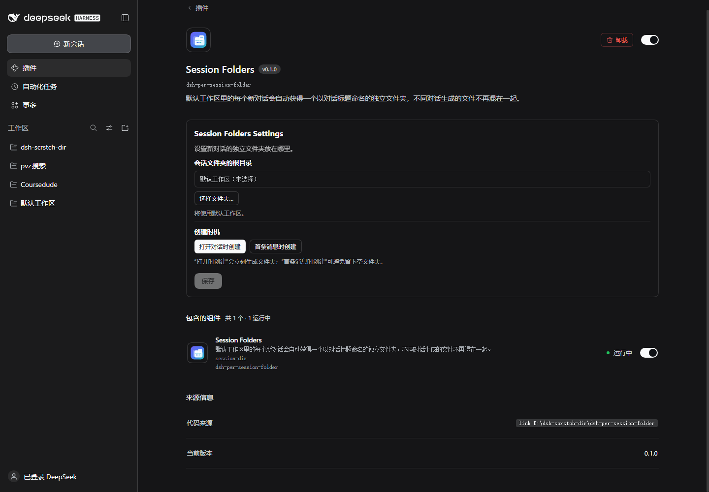

> **This is a patched fork.** Upstream: [hhuapen/dsh-per-session-folder](https://github.com/hhuapen/dsh-per-session-folder).
> Based on commit `main` @ v0.1.1 (2026-11-02) with one added compatibility layer in `client.js`;
> see [CHANGELOG.md](./CHANGELOG.md) for 0.1.2 and [issue #1 upstream](https://github.com/hhuapen/dsh-per-session-folder/issues/1) for the analysis.
>
> Install this fork instead of upstream:
> `dsh plugin add github:elliotwilde0-arch/dsh-per-session-folder`
> (or point the plugin manager's install spec at the same `github:` value).

# Session Folders

**One isolated folder per new conversation, with names that stay in sync with the session title.**

[中文文档](README.zh-CN.md)

Session Folders is a DSH host and client plugin for temporary or uncategorized conversations.
Every new session in the default workspace gets its own working directory without creating
another sidebar workspace or changing workspace ownership.



## Why

Scratch conversations often share the same default directory. One chat can leave scripts,
downloads, or test files that confuse the next chat. Session Folders isolates those files
at the filesystem level while preserving DSH's existing workspace and history model.

## Features

- Creates one folder for each new conversation in the default workspace.
- Uses the first message as an initial readable name.
- Renames the folder when the generated or edited session title changes.
- Resolves collisions with `-2`, `-3`, and so on.
- Uses the native Windows folder picker for the parent directory.
- Checks that the selected folder is accessible.
- Supports immediate creation or creation on the first message.
- Recovers folders and title synchronization after a DSH restart.
- Keeps DSH's Open In button and local-file actions pointed at the active session folder.
- Never creates extra workspace entries or changes historical workspace ownership.
- Leaves files written to explicit absolute paths elsewhere untouched.

## Requirements

- DSH `>=0.2.1-rc.3 <0.3.0`
- Node.js 22 or newer for development

## Install

```powershell
dsh plugin add dsh-per-session-folder
```

Before the npm package is published, install directly from GitHub:

```powershell
dsh plugin add github:hhuapen/dsh-per-session-folder
```

For a local checkout:

```powershell
dsh plugin add C:\path\to\dsh-per-session-folder
```

Restart DSH after installation.

## Setup

Open **Plugins → Installed plugins → Session Folders**.

The configuration embedded in the plugin detail page provides:

- **Choose folder…** — select the parent directory used for new session folders.
- **Use default workspace** — clear the custom parent directory.
- **Create on open** — allocate a folder as soon as a new chat is opened.
- **Create on first message** — avoid empty folders by waiting for the first prompt.

The selected folder is checked for accessibility. If a folder cannot be used, the session
continues in the default workspace instead of blocking the conversation.

## Configuration

| Key | Default | Description |
| --- | --- | --- |
| `enabled` | `true` | Enable per-session folders |
| `root` | `''` | Parent folder; empty uses the default workspace |
| `creationMode` | `immediate` | `immediate` or `first-message` |
| `workspacePath` | `''` | Optional workspace override for advanced setups |
| `maxNameChars` | `60` | Maximum folder-name length |

## Scope and behavior

Session Folders affects only new, top-level sessions whose original working directory is
the default workspace. Historical sessions, subagent sessions, and sessions in other
workspaces are left unchanged.

The session header keeps the original workspace path. Only the effective working directory
changes through `ctx.workingDirectory.set(agent, path)`, which is durable and replayed by DSH.
The client plugin mirrors that effective directory into DSH's session UI when the required
client interface is available, so directory-opening controls target the managed folder.

Each managed folder contains `.dsh-per-session-folder.json`. This marker lets the plugin
recover its folder after a restart. Folders created by the earlier development name retain
their legacy marker and are adopted automatically.

## Limitations

- Only operations that resolve relative to the current working directory are isolated.
  Absolute paths intentionally written elsewhere are not intercepted or moved.
- Changing the parent directory affects only future sessions. Existing folders stay put.
- The plugin never deletes or archives folders automatically.
- Renaming a folder can invalidate an old path already mentioned earlier in a model turn.
  The next model step receives a working-directory change notice.

## Development

```powershell
npm test
```

The test suite covers naming, collision handling, restart recovery, workspace scoping,
subagent exclusion, path failure fallback, deferred creation, and client directory syncing.

## License

[MIT](LICENSE)
